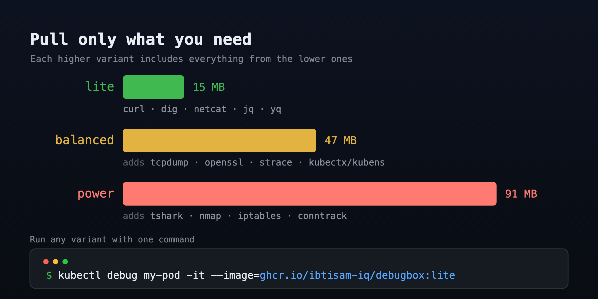
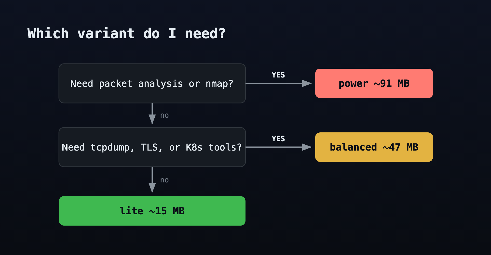

## Prerequisites

This tutorial assumes familiarity with `kubectl` and basic pod debugging concepts, specifically `kubectl debug` for attaching ephemeral containers and running standalone debug pods. If either is new, the [Kubernetes documentation on debugging running pods](https://kubernetes.io/docs/tasks/debug/debug-application/debug-running-pod/) and the [ephemeral containers concept page](https://kubernetes.io/docs/concepts/workloads/pods/ephemeral-containers/) cover the background needed before starting.

## What You Will Learn

By the end of this tutorial, you will know:

- When to reach for each DebugBox variant based on what the task actually requires
- How to attach an ephemeral container to a running pod with `kubectl debug`
- How to use a standalone debug pod when Linux capabilities are needed
- What shell helpers are available in each variant and how to invoke them

## The Problem with Monolithic Debugging Images

The dominant option for Kubernetes debugging is netshoot. It is comprehensive and well-maintained. It is also 202 MB, and you pull all 202 MB whether you need `dig` or `tshark`.

On edge clusters, metered connections, or environments with registry pull rate limits, that overhead adds up across teams and incidents.

DebugBox solves this with a tiered variant model:



All variants run as root by design. All are multi-arch (amd64 + arm64), published to both GHCR and Docker Hub, and Trivy-scanned on every release with a hard-fail on HIGH/CRITICAL findings.

## The Sample Application

The playground pre-deploys two workloads into the `debug-demo` namespace:

- **frontend**: a portfolio site (`ghcr.io/ibtisam-iq/ibtisam-iq:latest`) serving on port **8080**
- **backend**: an httpbin API server (`kennethreitz/httpbin`) serving on port **80**

These two services give us realistic targets: an HTTP frontend to probe for connectivity, and a JSON API backend to inspect with data tools.

Confirm both pods are running:

```bash
kubectl get pods -n debug-demo
```

::simple-task
---
:tasks: tasks
:name: check_app_running
---
#active
Verify both pods are running in the `debug-demo` namespace.

#completed
Both pods are running. The sample application is ready for debugging.
::

---

## Part 1: Debugging with Lite

Lite is for fast, targeted checks where pull speed matters more than tool breadth.

**Networking:** curl, netcat-openbsd, iproute2, iputils, bind-tools (dig / nslookup / host)

**Data:** jq, yq (Alpine apk version)

**Shell:** ash. Helpers: `json()` (pretty-print JSON), `yaml()` (pretty-print YAML)

### When to use lite

- DNS resolution check from inside a pod's network namespace
- HTTP endpoint reachability (does pod A reach service B on its actual port?)
- Verifying network policy behavior
- Inspecting JSON or YAML from a config map or API response

### Attaching an ephemeral container

Get the name of the frontend pod:

```bash
FRONTEND_POD=$(kubectl get pod -n debug-demo -l app=frontend -o jsonpath='{.items[0].metadata.name}')
echo $FRONTEND_POD
```

Attach a lite ephemeral container targeting the frontend's network namespace:

```bash
kubectl debug $FRONTEND_POD -n debug-demo -it \
  --image=ghcr.io/ibtisam-iq/debugbox:lite \
  --target=frontend \
  -- ash -l
```

::remark-box
---
kind: info
---
`--target=frontend` shares the network namespace of the `frontend` container. DNS, routing, and network interfaces are seen from the same perspective as the running application. This is the correct way to reproduce "what the app sees."
::

### Exercise 1: DNS check

From inside the ephemeral container, verify the backend service resolves:

```bash
dig backend.debug-demo.svc.cluster.local
```

You should see an `ANSWER SECTION` with the ClusterIP of the backend service. Exit the container when done.

::simple-task
---
:tasks: tasks
:name: lite_dns_check
---
#active
Run a DNS lookup for `backend.debug-demo.svc.cluster.local` from a lite ephemeral container attached to the frontend pod. Confirm the `ANSWER SECTION` appears in the output.

#completed
DNS check passed. The `ANSWER SECTION` confirms `backend.debug-demo.svc.cluster.local` resolves to a cluster IP from inside the frontend's network namespace.
::

### Exercise 2: HTTP reachability check

The frontend serves on port 8080. Attach to the frontend pod's network namespace and use `curl` and `json()` from the same session:

```bash
FRONTEND_POD=$(kubectl get pod -n debug-demo -l app=frontend -o jsonpath='{.items[0].metadata.name}')

kubectl debug $FRONTEND_POD -n debug-demo -it \
  --image=ghcr.io/ibtisam-iq/debugbox:lite \
  --target=frontend \
  -- ash -l
```

Inside the shell:

```bash
# Check frontend response headers (hitting localhost because we share the network namespace)
curl -si http://localhost:8080

# Inspect backend JSON response using the json() helper
curl -s http://backend.debug-demo.svc.cluster.local/json | json

exit
```

The `json()` helper pipes output through `jq` with color. The `yaml()` helper does the same for YAML via `yq`.

::simple-task
---
:tasks: tasks
:name: lite_http_check
---
#active
From a lite ephemeral container attached to the frontend pod, confirm the frontend responds on port 8080 and that the backend API is reachable.

#completed
HTTP check passed. The frontend responded on port 8080 and the backend JSON API is reachable from within the frontend's network namespace.
::

### When lite is not enough

If you need to capture packets, inspect TLS certificates, trace system calls, or switch Kubernetes contexts, move to balanced.

---

## Part 2: Debugging with Balanced

Balanced is the daily driver. It covers what most debugging sessions actually need.

**Shell and UX:** bash, bash-completion, less

**Editors:** vim

**HTTP and TLS:** openssl (curl inherited from lite)

**Version control:** git

**Filesystem:** file, tar, gzip

**Networking:** tcpdump, socat, mtr

**System:** htop, strace, lsof, procps, psmisc

**Kubernetes:** kubectx, kubens

**Shell:** bash. Helpers: `json()`, `yaml()`, `ports()` (ss -tulnp), `connections()` (ss -tunap), `routes()` (ip route show), `k8s-info()` (current context + namespace), `sniff()` (tcpdump on all interfaces), `sniff-http()` (HTTP traffic on ports 80/443), `sniff-dns()` (DNS queries on port 53), `cert-check()` (TLS certificate chain via openssl)

### Attaching balanced

```bash
BACKEND_POD=$(kubectl get pod -n debug-demo -l app=backend -o jsonpath='{.items[0].metadata.name}')

kubectl debug $BACKEND_POD -n debug-demo -it \
  --image=ghcr.io/ibtisam-iq/debugbox:balanced \
  --target=backend \
  -- bash -l
```

### Exercise 3: Inspect listening ports

Inside the balanced container, run the `ports` helper:

```bash
ports
```

This runs `ss -tulnp` and shows every socket the backend process has open.

::simple-task
---
:tasks: tasks
:name: balanced_ports_check
---
#active
Attach a balanced ephemeral container to the backend pod and run the `ports` helper.

#completed
Port inspection complete. The output shows what sockets the backend process has open and in what state.
::

### Exercise 4: Capture DNS traffic live

`sniff-dns` runs `tcpdump -i any -n -s 0 'port 53'`.

::remark-box
---
kind: warning
---
`tcpdump` requires `CAP_NET_RAW`. Ephemeral containers inherit the target pod's security context. If the pod does not grant `NET_RAW`, tcpdump will fail with "socket: Operation not permitted". Use the balanced debug pod from Exercise 5 instead: it requests `NET_RAW` explicitly in its pod spec.
::

In **terminal one**, enter the debug container interactively and start the capture:

```bash
BACKEND_POD=$(kubectl get pod -n debug-demo -l app=backend -o jsonpath='{.items[0].metadata.name}')

kubectl debug $BACKEND_POD -n debug-demo -it \
  --image=ghcr.io/ibtisam-iq/debugbox:balanced \
  --target=backend \
  -- bash -l
```

```bash
sniff-dns
```

tcpdump prints a warning about promiscuous mode on the `any` device. This is expected and the capture still works.

In **terminal two on `dev-machine`**, attach a second ephemeral container to the same backend pod so the DNS query comes from the same network namespace:

```bash
BACKEND_POD=$(kubectl get pod -n debug-demo -l app=backend -o jsonpath='{.items[0].metadata.name}')

kubectl debug $BACKEND_POD -n debug-demo \
  --image=ghcr.io/ibtisam-iq/debugbox:lite \
  --target=backend \
  -- ash -c 'dig frontend.debug-demo.svc.cluster.local'
```

Terminal two returns to the prompt immediately: the ephemeral container ran the query and exited. The dig output does not appear in terminal two. Watch terminal one: you will see the A query and its response appear in the capture.

The key is `--target=backend`: both containers share the same network namespace, so the DNS query from terminal two travels over the same `eth0` that terminal one is capturing.

::remark-box
---
kind: info
---
A pod in a different network namespace (like one created with `kubectl run`) generates DNS traffic on its own `eth0`; that traffic is never visible to `tcpdump` running in another pod's namespace. The `--target` flag is what makes the capture meaningful.
::

Press `Ctrl+C` in terminal one to stop the capture, then `exit` to leave the container.

### Exercise 5: Debug pod with NET_RAW (balanced)

When the target pod's security context does not grant `NET_RAW`, deploy a standalone balanced debug pod that requests it:

```bash
kubectl apply -n debug-demo -f \
  https://raw.githubusercontent.com/ibtisam-iq/debugbox/main/examples/balanced-debug-pod.yaml

kubectl wait -n debug-demo pod/debug-balanced --for=condition=ready --timeout=60s

kubectl exec -n debug-demo -it debug-balanced -- bash -l
```

From inside the pod, `sniff-dns`, `sniff`, and `sniff-http` all work because `NET_RAW` is granted in the pod spec. The `-l` flag is required to source the login profile that loads the shell helpers. Run `sniff-dns` here and use the terminal two technique from Exercise 4 to confirm the capture works.

### Exercise 6: Inspect a TLS certificate

The `cert-check()` function wraps `openssl s_client` to inspect the full certificate chain for any TLS endpoint. Pass a hostname and port as the two arguments:

```bash
cert-check <hostname> <port>
```

```bash
BACKEND_POD=$(kubectl get pod -n debug-demo -l app=backend -o jsonpath='{.items[0].metadata.name}')

kubectl debug $BACKEND_POD -n debug-demo -it \
  --image=ghcr.io/ibtisam-iq/debugbox:balanced \
  --target=backend \
  -- bash -l
```

```bash
cert-check kubernetes.default.svc.cluster.local 443
exit
```

The output shows the subject, issuer, validity period, and SAN entries for the certificate. The Kubernetes API server is always reachable from any pod and always serves TLS, making it a reliable in-cluster target.

### Exercise 7: Trace system calls

`strace` can trace a process it spawns directly. This produces guaranteed output. You control the process, so you know network syscalls will be made:

```bash
BACKEND_POD=$(kubectl get pod -n debug-demo -l app=backend -o jsonpath='{.items[0].metadata.name}')

kubectl debug $BACKEND_POD -n debug-demo -it \
  --image=ghcr.io/ibtisam-iq/debugbox:balanced \
  --target=backend \
  -- bash -lc 'strace -e trace=network -c curl -s http://backend.debug-demo.svc.cluster.local/json -o /dev/null'
```

`-e trace=network` filters to network syscalls only. `-c` prints a summary table on exit showing each syscall, how many times it was called, and total time spent. You will see `socket`, `connect`, `sendto`, and `recvfrom` entries from the curl request.

::remark-box
---
kind: warning
---
`strace` requires `SYS_PTRACE`. If the target pod's security context drops it, you will see "Operation not permitted". Use `lsof` and `ss` for lighter process inspection that does not require ptrace.
::

### When balanced is not enough

If you need protocol-level packet dissection, port scanning, bandwidth measurement, or firewall rule inspection, move to power.

---

## Part 3: Debugging with Power

Power carries tools that most sessions never need, but that are critical when they are needed.

**Network scanning:** nmap, nmap-nping, nmap-scripts

**Network performance:** iperf3, ethtool, iftop

**Deep packet analysis:** tshark, ngrep, tcptraceroute, fping

**System internals:** ltrace

**Firewall and routing:** iptables, nftables, conntrack-tools

**Data:** yq (pinned upstream binary, SHA-verified on each release, not the apk version)

**Shell:** bash. Adds over balanced: `conntrack-watch()` (list active conntrack entries, requires NET_ADMIN)

### Why power requires a debug pod

Several power tools require Linux capabilities beyond what ephemeral containers typically hold:

| Tool | Required Capability |
|---|---|
| tshark | `NET_ADMIN`, `NET_RAW` |
| iptables | `NET_ADMIN` |
| nftables | `NET_ADMIN` |
| conntrack-tools | `NET_ADMIN` |

The power debug pod example requests both without enabling `privileged` mode:

```yaml
securityContext:
  privileged: false
  capabilities:
    add:
    - NET_ADMIN
    - NET_RAW
```

### Exercise 8: Deploy the power debug pod

```bash
kubectl apply -n debug-demo -f \
  https://raw.githubusercontent.com/ibtisam-iq/debugbox/main/examples/power-debug-pod.yaml

kubectl wait -n debug-demo pod/debug-power \
  --for=condition=ready --timeout=60s
```

::simple-task
---
:tasks: tasks
:name: power_debug_pod
---
#active
Deploy the power debug pod into the `debug-demo` namespace and wait for it to be ready.

#completed
The power debug pod is running with `NET_ADMIN` and `NET_RAW` capabilities granted.
::

### Exercise 9: Protocol dissection with tshark

Exec into the power pod with a login shell:

```bash
kubectl exec -n debug-demo -it debug-power -- bash -l
```

`debug-power` has its own network namespace. tshark captures traffic that goes through this pod's network stack, which means traffic generated FROM this pod. `curl` is available in power (inherited from lite), so we use it to generate the HTTP requests and capture them in the same session.

Start tshark in the background, generate five requests to both services, then bring tshark back to the foreground:

```bash
tshark -i any -f 'tcp port 8080 or tcp port 80' \
  -Y 'http.request or http.response' \
  -T fields \
  -e http.request.method \
  -e http.request.uri \
  -e http.response.code \
  2>/dev/null &

sleep 1

for i in $(seq 1 5); do
  curl -s http://frontend.debug-demo.svc.cluster.local:8080/ > /dev/null
  curl -s http://backend.debug-demo.svc.cluster.local/json > /dev/null
  sleep 1
done

fg
```

Press `Ctrl+C` to stop tshark. With `-T fields`, tshark prints one row per packet: the request packet shows method and URI, the response packet shows URI and status code. You get two rows per HTTP exchange. Raw `tcpdump` gives you bytes; tshark gives you meaning.

::hint-box
---
:summary: Save to a pcap file for Wireshark
---
```bash
tshark -i any -f 'tcp port 8080' -w /tmp/capture.pcap
```

Copy to your local machine:
```bash
kubectl cp debug-demo/debug-power:/tmp/capture.pcap ./capture.pcap
```
::

### Exercise 10: Inspect the conntrack table

`conntrack-watch()` is a power-only shell helper that prints a snapshot of the active conntrack table. It runs `conntrack -L -o extended` and returns immediately.

::remark-box
---
kind: warning
---
In a standard Kubernetes application pod, `conntrack -L` typically shows 0 entries. Connection tracking for cluster traffic happens in the **host** network namespace where kube-proxy manages NAT, not inside the pod's own network namespace. `conntrack-watch` produces meaningful output when the pod itself has custom iptables DNAT or SNAT rules: network gateway pods, proxy appliances, or pods running a software load balancer. In those setups, each tracked connection appears as an entry with source, destination, protocol state, and remaining timeout.
::

Enter the pod with a login shell:

```bash
kubectl exec -n debug-demo -it debug-power -- bash -l
```

Run `conntrack-watch` to snapshot the table:

```bash
conntrack-watch
```

In a cluster where the pod's network namespace has active NAT rules, you will see entries like:

```
tcp      6 86390 ESTABLISHED src=10.244.1.5 dst=10.96.0.1 sport=43210 dport=443 ...
```

If the output shows `0 flow entries have been shown`, the pod's network namespace has no conntrack-tracked flows, which is normal for a standard application pod in most CNI setups.

---

## Choosing the Right Variant



When the task is unclear, balanced is the right default. At 47 MB it handles the majority of real-world debugging sessions without the capability requirements that power tools introduce.

::details-box
---
:summary: Full tool inventory by variant
---
**All variants (from base)**

ca-certificates

Shell: ash. Helpers: `ll()` (ls -alF)

---

**Lite (~15 MB)**

Networking: curl, netcat-openbsd, iproute2, iputils, bind-tools

Data: jq, yq (apk)

Shell: ash. Helpers: `json()`, `yaml()`

---

**Balanced (~47 MB) adds over lite**

Shell and UX: bash, bash-completion, less

Editors: vim

HTTP and TLS: openssl

Version control: git

Filesystem: file, tar, gzip

Networking: tcpdump, socat, mtr

System: htop, strace, lsof, procps, psmisc

Kubernetes: kubectx, kubens

Shell: bash. Helpers: `ports()`, `connections()`, `routes()`, `k8s-info()`, `sniff()`, `sniff-http()`, `sniff-dns()`, `cert-check()`

---

**Power (~91 MB) adds over balanced**

Network scanning: nmap, nmap-nping, nmap-scripts

Network performance: iperf3, ethtool, iftop

Deep packet analysis: tshark, ngrep, tcptraceroute, fping

System internals: ltrace

Firewall and routing: iptables, nftables, conntrack-tools

Data: yq (pinned upstream binary, replaces apk version)

Shell: bash. Helpers: `conntrack-watch()`
::

## Image References

```bash
# GHCR
ghcr.io/ibtisam-iq/debugbox:lite
ghcr.io/ibtisam-iq/debugbox:balanced
ghcr.io/ibtisam-iq/debugbox:power

# Docker Hub (mirror)
docker.io/mibtisam/debugbox:lite
docker.io/mibtisam/debugbox:balanced
docker.io/mibtisam/debugbox:power

# Pinned version tags
ghcr.io/ibtisam-iq/debugbox:balanced-1.2.0
```

## Cleanup

```bash
kubectl delete namespace debug-demo
```

## Where to Go Next

- **Source and Dockerfiles**: [github.com/ibtisam-iq/debugbox](https://github.com/ibtisam-iq/debugbox)
- **Full documentation**: [debugbox.ibtisam-iq.com](https://debugbox.ibtisam-iq.com)
- **Tool manifest** (authoritative list per variant): [docs/manifest.yaml](https://github.com/ibtisam-iq/debugbox/blob/main/docs/manifest.yaml)
- **Example pod manifests**: [examples/](https://github.com/ibtisam-iq/debugbox/tree/main/examples)
