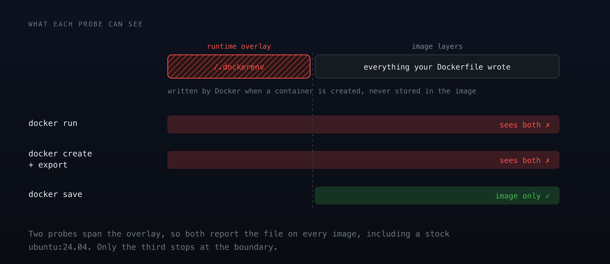

::remark-box
---
kind: warning
---
**Scope.** This tutorial builds a rootfs image for an **iximiuz Labs playground VM**, and the manifest and `labctl` steps in Part 7 are specific to this platform.

Those playgrounds happen to be Firecracker microVMs, so everything up to Part 7, the five boot requirements, the Dockerfile, and the validation script, applies just as well if you are preparing a rootfs for your own Firecracker or Cloud Hypervisor microVMs. Where a step depends on the platform doing something for you, it is called out.
::

## Prerequisites

This tutorial assumes you are comfortable writing a Dockerfile and running `docker build`, and that you have seen a systemd unit before. You do not need to know systemd well: the one distinction that matters, between enabling a unit and starting it, is explained where it comes up.

Nothing else is required. No Kubernetes, no `labctl`, no registry account, and no playground of your own: everything through Part 6b runs in this Docker playground, and Part 7 is read-along. If either area is new, the [Dockerfile reference](https://docs.docker.com/reference/dockerfile/) and [systemd's unit basics](https://www.freedesktop.org/software/systemd/man/latest/systemd.unit.html) cover more than enough background.

## What You Will Learn

By the end of this tutorial, you will know:

- Which five requirements separate a bootable rootfs image from an ordinary container image, and which of them a plain `ubuntu:24.04` fails
- Why SSH host keys and `machine-id` must never be **baked into** the image, and who regenerates them
- How to validate an image that you cannot boot, using assertions against a stopped image
- Why `docker run` answers almost nothing about a rootfs image, and what it can still be trusted for
- How to tell a broken image from a broken check, which turns out to be the harder skill

---

## The Two Artifacts Problem

`docker run -it ubuntu:24.04 bash` works. Hand that same image to iximiuz Labs as a playground's root filesystem and it does not boot.

Both are "an OCI image". Only one is a machine.

Playgrounds here run as Firecracker microVMs, and the drive you point a manifest at becomes the VM's root filesystem. So "custom playground" really means "custom rootfs image".

A container borrows the host's kernel and gets one process started for it. A microVM is handed a kernel and has to bring itself up from there, which is work a container image has never been asked to do.

You will build a deliberately broken rootfs, watch it fail the requirements, fix it, then write a validation script that proves an image would boot **without booting it**, because you cannot boot it here.

::remark-box
---
kind: info
---
Two senses of "playground" are about to sit next to each other, so to be explicit: you are working **inside** a Docker playground, building a rootfs image that would become **a different** playground's root drive.
::

---

## Part 1: The Five Requirements

An image used as a playground's root drive has to satisfy exactly these:

| Requirement | Why |
|---|---|
| `linux/amd64` | The platform runs amd64 microVMs |
| No kernel | The platform supplies it; your image provides everything from `/sbin/init` up |
| An init system | systemd for most distributions, OpenRC for Alpine |
| `sshd` on `0.0.0.0:22` at boot | Terminal tabs and `labctl ssh` are SSH |
| Users already exist in the image | The platform does not create them |

::remark-box
---
kind: warning
---
Two delivery rules on top of those five: the image must be **publicly pullable**, and it **cannot live on Docker Hub** (rate limiting). GHCR is the recommended registry. A manifest pointing at a private image, or at Docker Hub, fails at start time rather than build time.
::

Notice what is *not* on that list: no `CMD`, no `ENTRYPOINT`. The platform boots `/lib/systemd/systemd` itself and never reads the OCI config's entrypoint fields.

---

## Part 2: Build the Naive Version

### First, start two downloads

Parts 6 and 6b compare your image against two published rootfs images. They are large, and nothing before Part 6 touches them, so start them now and let them arrive while you work:

```bash
docker pull ghcr.io/iximiuz/labs/rootfs:ubuntu-24-04      > /tmp/pull-1.log 2>&1 &
docker pull ghcr.io/ibtisam-iq/ubuntu-24-04-rootfs:latest > /tmp/pull-2.log 2>&1 &
```

The trailing `&` hands your prompt straight back. By the time you reach Part 6 they will already be local.

### Now the image

Create the working directory:

```bash
cd ~/rootfs-lab
```

Write the obvious Dockerfile:

```bash
cat > Dockerfile.naive <<'EOF'
FROM ubuntu:24.04

RUN apt-get update && \
    apt-get install -y --no-install-recommends curl vim && \
    rm -rf /var/lib/apt/lists/*

CMD ["/bin/bash"]
EOF
```

Build it:

```bash
docker build -f Dockerfile.naive -t naive-rootfs:v1 .
```

It builds cleanly. It runs cleanly. Confirm what it is missing:

```bash
docker run --rm --entrypoint sh naive-rootfs:v1 -c '
  test -x /lib/systemd/systemd && echo "systemd:  yes" || echo "systemd:  MISSING"
  command -v sshd >/dev/null   && echo "sshd:     yes" || echo "sshd:     MISSING"
  id laborant >/dev/null 2>&1  && echo "user:     yes" || echo "user:     MISSING"
'
```

```
systemd:  MISSING
sshd:     MISSING
user:     MISSING
```

Three failures. Handed to the platform, this image would be given a kernel, the kernel would look for an init system, find nothing usable, and panic.

::details-box
---
:summary: Why every line prints an explicit yes or MISSING
---
Because the tools do not report consistently. `ls` writes an error to stderr, `id` writes a different one, and `which sshd` prints **nothing at all**, communicating only through its exit code.

A check whose failure mode is silence is a bad check: you cannot tell "passed" from "never ran". The validation script later labels every line for the same reason.
::

::simple-task
---
:tasks: tasks
:name: naive_image_built
---
#active
Build `naive-rootfs:v1` from `Dockerfile.naive` and confirm it does **not** contain a systemd binary.

#completed
Confirmed. The image builds and runs as a container, and has no init system, which is precisely why it cannot boot as a VM.
::

---

## Part 3: Make It Bootable

Four things have to be added, and one class of thing has to be deliberately **removed**.

```bash
cat > Dockerfile.bootable <<'EOF'
FROM ubuntu:24.04

ENV DEBIAN_FRONTEND=noninteractive

# 1. Init system, SSH, and a usable userland
RUN apt-get update && \
    apt-get install -y --no-install-recommends \
        systemd systemd-sysv \
        openssh-server \
        sudo ca-certificates curl vim iproute2 && \
    rm -rf /var/lib/apt/lists/*

# 2. The interactive user the manifest will name
RUN useradd -m -s /bin/bash laborant && \
    echo 'laborant ALL=(ALL) NOPASSWD:ALL' > /etc/sudoers.d/laborant && \
    chmod 0440 /etc/sudoers.d/laborant

# 3. Enable sshd at boot (enable, not start: there is no init running in a build)
RUN systemctl enable ssh

# 4. Strip the per-machine identity that must NOT be shared
RUN rm -f /etc/ssh/ssh_host_* && \
    : > /etc/machine-id && \
    rm -f /var/lib/dbus/machine-id && \
    rm -f /.dockerenv
EOF
```

Build it:

```bash
docker build -f Dockerfile.bootable -t bootable-rootfs:v1 .
```

Three of those steps are ordinary. Two deserve explanation.

### `systemctl enable`, not `systemctl start`

There is no init system running during `docker build`. `systemctl start` would fail. `systemctl enable` does not start anything; it writes a symlink into `/etc/systemd/system/multi-user.target.wants/`, which systemd reads on the next real boot.

That is the whole bake-versus-boot distinction in one command. Verify the symlink is what you actually produced:

```bash
docker run --rm --entrypoint sh bootable-rootfs:v1 -c \
  'ls -l /etc/systemd/system/multi-user.target.wants/ssh.service'
```

### Deleting the host keys is the point

This is the step that looks like a mistake. `openssh-server` generates SSH host keys at install time, and those keys are the machine's cryptographic identity.

::remark-box
---
kind: warning
---
Leave them in the image and **every VM anyone ever boots from it shares one identity**. Anyone who pulls your public image holds the private host keys of every machine running it.

On iximiuz Labs you are covered either way: the platform strips and regenerates host keys at first boot, so this line is defence in depth rather than a hard requirement. The official base images delete them too, for the same reason it is worth doing here, to keep the step visible.

Keep it. The moment you boot this rootfs on your own Firecracker or Cloud Hypervisor VM, nothing is doing it for you.
::

`/etc/machine-id` is the same problem in a smaller form: systemd uses it to identify the machine, and a shared one produces duplicate journald IDs and DHCP collisions.

::simple-task
---
:tasks: tasks
:name: bootable_image_built
---
#active
Build `bootable-rootfs:v1` and confirm it now has systemd, `sshd`, the `laborant` user, and an enabled `ssh.service` symlink.

#completed
All four present. The image now satisfies the init-system, SSH, and user requirements.
::

::simple-task
---
:tasks: tasks
:name: host_keys_absent
---
#active
Confirm the image ships **no** SSH host keys and an **empty** `/etc/machine-id`. This is a test that asserts something is missing.

#completed
Correct. Absent host keys and an empty machine-id mean every VM booted from this image generates its own identity.
::

---

## Part 4: Validate What You Cannot Boot

You cannot boot this image here. So how do you know it is correct before publishing it?

You assert the *observable consequences* of each requirement. Every check below runs against a stopped image:

```bash
cat > validate.sh <<'EOF'
#!/usr/bin/env bash
set -uo pipefail
IMAGE="${1:?usage: validate.sh <image>}"
fail=0

check() {
  local label="$1"; shift
  if docker run --rm --entrypoint sh "$IMAGE" -c "$1" >/dev/null 2>&1; then
    printf '  ok    %s\n' "$label"
  else
    printf '  FAIL  %s\n' "$label"; fail=1
  fi
}

echo "Validating $IMAGE"
check "init system present"     'test -x /lib/systemd/systemd'
check "sshd present"            'test -x /usr/sbin/sshd'
check "ssh enabled at boot"     'test -L /etc/systemd/system/multi-user.target.wants/ssh.service'
check "interactive user exists" 'id laborant'
check "no SSH host keys"        '! ls /etc/ssh/ssh_host_* >/dev/null 2>&1'
check "machine-id empty"        'test ! -s /etc/machine-id'

# /.dockerenv is deliberately NOT checked with the helper above, and not with
# `docker export` either. Both report it on every image in existence. Only the
# image layers tell the truth. See the note below.
tmpd=$(mktemp -d)
docker save "$IMAGE" | tar -x -C "$tmpd"
dockerenv=0
for f in $(find "$tmpd" -type f \( -name 'layer.tar' -o -path '*blobs/sha256/*' \)); do
  if tar -tf "$f" 2>/dev/null | grep -q '^\.dockerenv$'; then dockerenv=1; break; fi
done
rm -rf "$tmpd"
if [ "$dockerenv" -eq 0 ]; then
  printf '  ok    .dockerenv absent from image layers\n'
else
  printf '  FAIL  .dockerenv baked into an image layer\n'; fail=1
fi

arch=$(docker image inspect --format '{{.Architecture}}' "$IMAGE")
if [ "$arch" = "amd64" ]; then printf '  ok    architecture is amd64\n'
else printf '  FAIL  architecture is %s\n' "$arch"; fail=1; fi

exit $fail
EOF

chmod +x validate.sh
```

::remark-box
---
kind: info
---
That is the longest paste in this tutorial, and long heredocs sometimes garble in a browser terminal. If the echoed text looks scrambled, check the file with `cat validate.sh` before running it, or use the **IDE** tab to create it instead.
::

### The check where two obvious methods are both wrong

Every check above uses `docker run` except `/.dockerenv`. That exception took me three attempts to get right, and the two wrong turns are more instructive than the answer.

**Attempt 1: test it inside the container.**

```bash
docker run --rm --entrypoint sh bootable-rootfs:v1 -c 'ls -l /.dockerenv'
```

It is there, despite `rm -f /.dockerenv` in the Dockerfile. `/.dockerenv` is created by the Docker **runtime**, not stored in the image, so the act of running the test creates the file being tested for. This check can never pass.

**Attempt 2: create a container without starting it, and export its filesystem.**

```bash
cid=$(docker create bootable-rootfs:v1)
docker export "$cid" | tar -t | grep -c '^\.dockerenv$'
docker rm "$cid"
```

Reports it present. Which looks like a real finding, until you run the control:

```bash
docker create --name ctrl-check ubuntu:24.04 >/dev/null
docker export ctrl-check | tar -t | grep -c '^\.dockerenv$'
docker rm ctrl-check >/dev/null
```

Stock `ubuntu:24.04` reports it too, and stock Ubuntu certainly does not ship `/.dockerenv`. The runtime injects it at **create** time, not start time, so `docker export` is contaminated for every image. Attempt 2 is as useless as attempt 1, and worse, because it produces a confident false positive.

**Attempt 3: read the image layers and never make a container.**

```bash
tmpd=$(mktemp -d)
docker save bootable-rootfs:v1 | tar -x -C "$tmpd"
for f in $(find "$tmpd" -type f \( -name 'layer.tar' -o -path '*blobs/sha256/*' \)); do
  tar -tf "$f" 2>/dev/null | grep -q '^\.dockerenv$' && echo "FOUND in $f"
done
rm -rf "$tmpd"
```

Silence. It is genuinely not in any layer. `docker save` streams the image itself rather than a container built from it, which is the only view without a runtime in the way.



::remark-box
---
kind: warning
---
**The control experiment is the technique worth stealing.** Attempt 2 gave a plausible answer, and nothing about it looked broken. What exposed it was running the same test against an image whose answer was known in advance. When a check reports a problem, point it at something you are certain is clean before you believe it.
::

::details-box
---
:summary: An honest caveat about this particular check
---
Docker never bakes `/.dockerenv` into layers under normal builds, so this check passes for essentially any image, and the `rm -f /.dockerenv` in the Dockerfile is defensive rather than load-bearing.

Its value here is not the assertion. It is that a requirement can look trivially testable and have two plausible tests that are both wrong.

`docker save` is also the slowest check in the script, since it streams the whole image, which is why it runs last.
::

### Run it

```bash
bash validate.sh naive-rootfs:v1 ; echo "exit=$?"
bash validate.sh bootable-rootfs:v1 ; echo "exit=$?"
```

The naive image fails several checks and exits non-zero. The bootable one passes and exits `0`.

::remark-box
---
kind: info
---
Put this in the image's CI pipeline as a `RUN` step before the final `CMD`, and a broken image can never reach your registry. That is worth more than it looks: the alternative is discovering the problem when a learner clicks Start and gets a machine that never finishes booting.
::

::simple-task
---
:tasks: tasks
:name: validation_script_passes
---
#active
Write `validate.sh` in `~/rootfs-lab` and get it passing against `bootable-rootfs:v1`.

#completed
The image is now provably correct against every requirement that can be checked without a kernel.
::

---

## Part 5: What `docker run` Cannot Tell You

Try to start the image the way you would any container:

```bash
docker run --rm bootable-rootfs:v1 systemctl is-system-running
```

```
offline
```

That one word is the correct result. `offline` is what `systemctl` reports when it cannot reach a running system manager. It is **not** saying the image is broken or that systemd is missing: the binary is right there, installed and enabled. It is saying nothing has booted it, and inside `docker run` nothing ever will, because PID 1 is your `systemctl` process rather than systemd.

::remark-box
---
kind: warning
---
Note what did **not** happen: no error, no crash, no stack trace. Just a tidy, plausible-looking one-word answer.

Skim for something obviously broken and you move on satisfied, having learned almost nothing about whether this image actually boots. Quiet output is not the same as a passing result.
::

So `docker run` against a rootfs image answers a narrow band of questions:

| Question | Answerable with `docker run`? |
|---|---|
| Is the binary present? | Yes |
| Is it readable by the right user? | Yes |
| Is the unit symlinked into `multi-user.target.wants/`? | Yes |
| Does the service actually start? | No |
| Does `sshd` bind to `0.0.0.0:22`? | No |
| Is the boot ordering correct? | No |
| Does networking come up? | No |

Everything in the No column only exists once a kernel boots the filesystem, which is the platform's job, not Docker's.

::remark-box
---
kind: info
---
This is exactly why the validation script checks **symlinks** rather than running services. A symlink is a fact you can observe in a stopped image. "The service started" is not.
::

---

## Part 6: The Same Thing, The Easy Way

First, confirm the two background pulls from Part 2 have landed:

```bash
docker images | grep -E 'labs/rootfs|ubuntu-24-04-rootfs'
```

Both should be listed. If not, check `/tmp/pull-1.log` and `/tmp/pull-2.log`, or just run the pulls again in the foreground.

Everything in Part 3 exists so that the platform's base images do not have to be re-derived by every author. Compare:

```bash
cat > Dockerfile.official <<'EOF'
FROM ghcr.io/iximiuz/labs/rootfs:ubuntu-24-04

# The official rootfs images end as a non-root user. Switch back before installing.
USER root

RUN apt-get update && \
    apt-get install -y --no-install-recommends postgresql-16 && \
    rm -rf /var/lib/apt/lists/*
EOF

docker build -f Dockerfile.official -t official-rootfs:v1 . && \
  bash validate.sh official-rootfs:v1
```

### That `USER root` line is not optional

Leave it out and the build fails:

```
E: Could not open lock file /var/lib/apt/lists/lock - open (13: Permission denied)
E: Unable to lock directory /var/lib/apt/lists/
```

Inheriting an image inherits its final `USER`, and these bases end as an unprivileged account so that `docker run` lands you somewhere sensible. `apt-get` then cannot write to `/var/lib/apt/lists`. It is a one-line fix that reads like a permissions bug in your own Dockerfile, which is why it is worth seeing once.

::remark-box
---
kind: info
---
You do not need to switch back to the non-root user at the end. The `USER` field is an OCI image-config setting that tells `docker run` who to start as; the platform boots this filesystem with its own kernel, and systemd takes PID 1 regardless. Which user your terminal logs in as comes from the manifest, not from here.
::

Two lines of real content. Then the validation says this:

```
Validating official-rootfs:v1
  ok    init system present
  ok    sshd present
  FAIL  ssh enabled at boot
  ok    interactive user exists
  ok    no SSH host keys
  FAIL  machine-id empty
  ok    .dockerenv absent from image layers
  ok    architecture is amd64
```

Two failures, against the platform's **own reference image**. The one every custom playground is supposed to inherit from.

::remark-box
---
kind: warning
---
When your check fails the reference implementation, the check is what is broken.

That is worth sitting with for a second before reading on, because the instinct is to go looking for what is wrong with the image.
::

### Failure 1: `ssh enabled at boot`

Ask the image how it enables sshd:

```bash
docker run --rm --entrypoint sh ghcr.io/iximiuz/labs/rootfs:ubuntu-24-04 -c '
  find /etc/systemd -name "*ssh*" 2>/dev/null
'
```

```
/etc/systemd/system/sockets.target.wants/ssh.socket
/etc/systemd/system/ssh.service.requires/ssh.socket
...
```

No `multi-user.target.wants/ssh.service` anywhere. This image uses **socket activation**, which is the Ubuntu 24.04 default: systemd listens on port 22 itself and starts `sshd` on the first connection. The image you built in Part 3 uses `ssh.service` instead, because `systemctl enable ssh` on a fresh install picks the service unit.

Both satisfy the Part 1 requirement. `sshd` answers on `0.0.0.0:22` at boot either way. My check asserted one of the two mechanisms and called it the rule.

Widen it to accept either:

```bash
sed -i "s#check \"ssh enabled at boot\"     'test -L /etc/systemd/system/multi-user.target.wants/ssh.service'#check \"sshd starts at boot\"      'ls /etc/systemd/system/multi-user.target.wants/ssh.service /etc/systemd/system/sockets.target.wants/ssh.socket 2>/dev/null | grep -q .'#" validate.sh
```

### Failure 2: `machine-id empty`

```bash
docker run --rm --entrypoint sh ghcr.io/iximiuz/labs/rootfs:ubuntu-24-04 \
  -c 'stat -c%s /etc/machine-id'
```

One byte, not zero. `test ! -s` demands exactly zero bytes, and a file holding a single newline is not that. systemd treats empty and whitespace-only identically: both mean uninitialised, both get a fresh ID at first boot. The check was testing one way of writing the file rather than the property that matters.

```bash
sed -i "s#check \"machine-id empty\"        'test ! -s /etc/machine-id'#check \"machine-id uninitialised\" '[ ! -s /etc/machine-id ] || [ -z \"\$(tr -d \"[:space:]\" < /etc/machine-id)\" ]'#" validate.sh
```

Re-run and the reference image passes:

```bash
bash validate.sh official-rootfs:v1 ; echo "exit=$?"
```

Nothing about the image changed. Two assertions stopped mistaking an implementation for a requirement.

**Use this unless understanding the base is your actual goal.** Part 3 is worth doing once, so that when a machine fails to boot you know which of the five requirements to suspect. After that, inherit.

---

## Part 6b: Point It at an Image You Did Not Build

Part 6 already broke this script against the platform's own base. Now point it at one built by a third party, with different conventions again.

This one is mine. I built it the hard way, exactly as in Part 3, and it currently backs five public playgrounds:

```bash
bash validate.sh ghcr.io/ibtisam-iq/ubuntu-24-04-rootfs:latest ; echo "exit=$?"
```

One check fails:

```
  FAIL  interactive user exists
```

The other two you already fixed in Part 6, and they stay fixed here. That is the point of widening a check rather than special-casing an image: my `machine-id` also holds a single newline, and the repaired assertion accepts it without being told about it.

This last one is different, and it is the most instructive of the three.

### The one that cannot be widened

`id laborant` is hardcoded. That image creates `ibtisam` instead.

Neither name is more correct. The rule from Part 1 is that **the users your manifest names must exist in the image**, and which names those are is the image author's decision. There is no clever assertion that covers every case, because the correct answer genuinely differs per image.

So it stops being a constant and becomes an input:

```bash
sed -i 's|^IMAGE=.*|IMAGE="${1:?usage: validate.sh <image> [login-user]}"\nLOGIN_USER="${2:-laborant}"|' validate.sh
sed -i "s|check \"interactive user exists\" 'id laborant'|check \"login user exists\"       \"id \$LOGIN_USER\"|" validate.sh
```

Now the caller supplies what only the caller can know:

```bash
bash validate.sh ghcr.io/ibtisam-iq/ubuntu-24-04-rootfs:latest ibtisam ; echo "exit=$?"
bash validate.sh bootable-rootfs:v1 ; echo "exit=$?"
```

Both exit `0`. The script now expresses the requirement rather than one way of satisfying it, and takes the genuinely variable part as an argument.

::remark-box
---
kind: info
---
Three failures, three different repairs, and the difference between them is the useful bit.

**`ssh`** had two valid mechanisms, so the check widened to accept both. **`machine-id`** had two valid encodings of the same state, so the check tested the state instead. **The user** has no universal answer at all, so it became a parameter.

Reaching for a parameter first is the common mistake. It works, and it pushes the thinking onto whoever runs the script.
::

::simple-task
---
:tasks: tasks
:name: thirdparty_validation_passes
---
#active
Apply all three repairs (the two from Part 6 plus the login-user parameter) so `validate.sh` passes against `ghcr.io/ibtisam-iq/ubuntu-24-04-rootfs:latest` with login user `ibtisam`, **and still passes** against your own `bootable-rootfs:v1`.

#completed
The script now generalises. It validates images you did not build, which is the only way to know it encodes the requirement rather than your own habits.
::

::remark-box
---
kind: info
---
None of the three was a flaw in an image. Every one was the script mistaking one author's habits for the requirement, and it stayed invisible for exactly as long as that author only pointed it at his own work. The platform's own reference image was the first thing to expose it.
::

---

## Part 7: Publishing It

These steps push to your own registry and create a playground under your own account, so they cannot be verified from inside this sandbox. Read along, then run them in your terminal afterwards.

Push the image somewhere public that is not Docker Hub:

```bash
echo "$GITHUB_TOKEN" | docker login ghcr.io -u <your-username> --password-stdin
docker tag bootable-rootfs:v1 ghcr.io/<your-username>/my-rootfs:v1
docker push ghcr.io/<your-username>/my-rootfs:v1
```

Point a manifest at it:

```yaml
kind: playground
title: My Custom Playground
description: A one-line summary shown on the card.
categories:
  - linux
playground:
  networks:
    - name: local
      subnet: 172.16.0.0/24
  machines:
    - name: dev-01
      users:
        - name: root
        - name: laborant
          default: true
      drives:
        - source: oci://ghcr.io/<your-username>/my-rootfs:v1
          mount: /
          size: 30GiB
      network:
        interfaces:
          - network: local
      resources:
        cpuCount: 2
        ramSize: 2GiB
  accessControl:
    canList: [owner]
    canRead: [owner]
    canStart: [owner]
```

Create it:

```bash
labctl playground create my-custom-playground --base flexbox -f manifest.yaml
```

`--base flexbox` is not incidental. It is the only base that accepts an arbitrary set of machines; every other base keeps its own and rejects new or renamed ones.

::remark-box
---
kind: info
---
That is the whole handoff, and deliberately so. Everything past this point (the dump-edit-update loop, init tasks, the Playground Constructor UI, access control beyond `owner`) is covered properly in [Your First Custom Playground](https://labs.iximiuz.com/docs/custom-playgrounds/first-custom-playground) and the [manifest reference](https://labs.iximiuz.com/docs/custom-playgrounds/manifest-reference). Go there next rather than taking my abbreviated version as the full story.

What this tutorial gave you that those pages assume you already have is the **image** on the other end of that `oci://` line.
::

::remark-box
---
kind: warning
---
**Unknown manifest keys are silently discarded.** Write `format: ext4` when the field is actually `filesystem` and nothing errors, warns, or fails. The key is dropped and you believe you configured something you did not. This one is not in the docs, and I found it by diffing my own submitted manifest against `labctl playground manifest <full-name>`. Do that diff.
::

::remark-box
---
kind: info
---
Free-tier accounts can hold **one custom playground at a time**. If `create` refuses and you already have one, that is why, not a problem with your manifest.
::

---

## What You Built

A container image becomes a bootable rootfs when it stops assuming a kernel will hand it a single process, and starts assuming it has to bring a machine up on its own. Concretely:

| What changed | Why |
|---|---|
| An init system | Something has to take PID 1 |
| `sshd` **enabled**, not started | There is no init running during a build |
| A user that pre-exists | The platform never creates one |
| Host keys and machine-id **absent** | Otherwise every VM shares one identity |

::remark-box
---
kind: info
---
The validation script is the part worth keeping. It encodes those requirements as assertions against a **stopped** image, which is the only kind of check available before a kernel exists, and it turns "I think this will boot" into something CI can answer.

It also taught you two things about itself along the way: that a plausible test can be contaminated by the runtime, and that a script only ever pointed at its author's own images encodes their habits as requirements.
::

::details-box
---
:summary: The finished validate.sh, after all three repairs
---
Five `sed` commands across Parts 6 and 6b mutated the Part 4 version into this. Here it is whole, so you can lift it without replaying them:

```bash
#!/usr/bin/env bash
set -uo pipefail
IMAGE="${1:?usage: validate.sh <image> [login-user]}"
LOGIN_USER="${2:-laborant}"
fail=0

check() {
  local label="$1"; shift
  if docker run --rm --entrypoint sh "$IMAGE" -c "$1" >/dev/null 2>&1; then
    printf '  ok    %s\n' "$label"
  else
    printf '  FAIL  %s\n' "$label"; fail=1
  fi
}

echo "Validating $IMAGE"
check "init system present"      'test -x /lib/systemd/systemd'
check "sshd present"             'test -x /usr/sbin/sshd'
check "sshd starts at boot"      'ls /etc/systemd/system/multi-user.target.wants/ssh.service /etc/systemd/system/sockets.target.wants/ssh.socket 2>/dev/null | grep -q .'
check "login user exists"        "id $LOGIN_USER"
check "no SSH host keys"         '! ls /etc/ssh/ssh_host_* >/dev/null 2>&1'
check "machine-id uninitialised" '[ ! -s /etc/machine-id ] || [ -z "$(tr -d "[:space:]" < /etc/machine-id)" ]'

# /.dockerenv cannot be checked from a container: the runtime injects it at create
# time, so docker run AND docker export report it on every image. Read the layers.
tmpd=$(mktemp -d)
docker save "$IMAGE" | tar -x -C "$tmpd"
dockerenv=0
for f in $(find "$tmpd" -type f \( -name 'layer.tar' -o -path '*blobs/sha256/*' \)); do
  if tar -tf "$f" 2>/dev/null | grep -q '^\.dockerenv$'; then dockerenv=1; break; fi
done
rm -rf "$tmpd"
if [ "$dockerenv" -eq 0 ]; then
  printf '  ok    .dockerenv absent from image layers\n'
else
  printf '  FAIL  .dockerenv baked into an image layer\n'; fail=1
fi

arch=$(docker image inspect --format '{{.Architecture}}' "$IMAGE")
if [ "$arch" = "amd64" ]; then printf '  ok    architecture is amd64\n'
else printf '  FAIL  architecture is %s\n' "$arch"; fail=1; fi

exit $fail
```

```bash
bash validate.sh <image> [login-user]   # login-user defaults to laborant
```

Two quoting details worth preserving if you edit it. The login check uses **double** quotes so the outer shell expands `$LOGIN_USER` before the string reaches `docker run`. The machine-id check uses **single** quotes so `$(tr ...)` survives to the container's `sh -c` instead of running on your host. Swap either and the check silently tests the wrong machine.
::

### Where next

- [Custom Rootfs Images](https://labs.iximiuz.com/docs/custom-playgrounds/custom-rootfs) and the [manifest reference](https://labs.iximiuz.com/docs/custom-playgrounds/manifest-reference) in the official docs, which cover the full schema this tutorial only touches
- [Init tasks](https://labs.iximiuz.com/docs/custom-playgrounds/init-tasks) if you would rather provision at boot than bake into the image
- [Official rootfs image definitions](https://github.com/iximiuz/labs) for a base to inherit from instead of writing your own
- [My six systemd rootfs images](https://github.com/ibtisam-iq/silver-stack/tree/main/iximiuz/rootfs), built with exactly this pattern, including Jenkins, SonarQube and Nexus. The Ubuntu base among them is the image you validated in Part 6b.
- [Building an OCI Image That Boots as a microVM, Not a Container](https://blog.ibtisam-iq.com/docker-rootfs-systemd-cicd/), the long-form version of Parts 1 to 5, covering the six rootfs images this pattern produced and the failures behind each build step
- Also on my blog: [publishing a custom playground end to end](https://blog.ibtisam-iq.com/iximiuz-labs-custom-playground-rootfs-manifest/) and [where provisioning should live](https://blog.ibtisam-iq.com/iximiuz-labs-playground-init-tasks-provisioning/)
